 # TREKIA

| Recurso | Enlace |
|---|---|
| Repositorio | [github.com/sharkreiza/TREKIA](https://github.com/sharkreiza/TREKIA) |
| Prototipo en Figma | [Ver prototipo](https://www.figma.com/design/2TYPZLo0IrNCWRyVobiGK7/Sin-t%C3%ADtulo) |
| Informe EP1 | [Ver informe](docs/Informe-EP1.pdf) |


## Integrantes y responsabilidades

| Integrante | Responsabilidades |
|---|---|
| Antonia Albar | _parte 1.1 y 1.2_ |
| Vicente Girardin | _figma_ |
| Camila Ramirez | _1.4,1.5,1.6 · EP 2.4 y 2.5: integración con la API, sesión con JWT y roles_ |

## Descripción del sistema

Trekia reúne en un solo lugar la información de rutas de trekking y a las personas que las recorren. Los usuarios pueden ver las rutas en un mapa, revisar su dificultad, distancia y duración, leer comentarios de otras personas, crear grupos para salir acompañados y proponer rutas que todavía no aparecen en la plataforma.

El sistema tiene dos roles:

- **Usuario:** explora rutas, comenta, crea y se une a grupos, agrega amigos, gestiona su perfil y propone rutas nuevas.
- **Administrador:** revisa las rutas propuestas por los usuarios y decide si se publican o se rechazan.


## Problema que aborda

Las personas interesadas en hacer trekking tienen dificultades para encontrar información suficiente y centralizada sobre algunas rutas, evaluar si son adecuadas para su nivel y encontrar compañeros con quienes salir de forma organizada.

El problema se divide en tres partes:

- **Falta de información:** muchas rutas conocidas por gente con experiencia no tienen presencia digital suficiente, o su información está dispersa en distintas plataformas.
- **Seguridad:** SENAPRED recomienda planificar las salidas a la montaña y no hacerlas en solitario, pero no siempre es fácil encontrar con quién ir.
- **Componente social:** alguien puede querer hacer una ruta y no tener amigos disponibles, o sentirse inseguro saliendo con desconocidos sin ningún control sobre quién participa.

## Objetivos

**Objetivo general:** desarrollar una plataforma web y móvil que centralice información de rutas de trekking y facilite la organización de salidas grupales.

**Objetivos específicos:**

- Mostrar las rutas en un mapa interactivo con su información detallada.
- Permitir buscar y filtrar rutas según dificultad, ubicación y distancia.
- Facilitar la creación de grupos, con control del creador sobre quién participa.
- Permitir que la comunidad proponga rutas nuevas, revisadas por un administrador antes de publicarse.
- Ofrecer una experiencia coherente tanto en computador como en celular.


## Principales funcionalidades

- Mapa interactivo con marcadores de rutas y filtros.
- Ficha de cada ruta con dificultad, distancia, duración y comentarios.
- Creación y búsqueda de grupos de trekking, con solicitudes de participación.
- Comunidad con publicaciones, grupos, eventos y solicitudes de amistad.
- Propuesta de rutas nuevas.
- Cuenta con perfil, estadísticas y configuración.
- Panel de administrador para aprobar o rechazar rutas propuestas.


## Requerimientos funcionales

| ID | Nombre | Rol | Descripción |
|---|---|---|---|
| RF-01 | Visualización de rutas en mapa interactivo | Usuario | El sistema deberá permitir visualizar las rutas de trekking disponibles mediante marcadores en un mapa interactivo. |
| RF-02 | Consulta detallada de una ruta | Usuario | El sistema deberá permitir seleccionar una ruta y consultar su nombre, ubicación, descripción, dificultad, distancia, inclinación, duración estimada y recorrido. |
| RF-03 | Búsqueda y filtrado de rutas | Usuario | El sistema deberá permitir buscar y filtrar rutas según dificultad, ubicación, distancia y otras características. |
| RF-04 | Publicación de experiencias y comentarios | Usuario | El sistema deberá permitir publicar comentarios asociados a una ruta para compartir experiencias, recomendaciones y advertencias. |
| RF-05 | Creación de grupos de trekking | Usuario | El sistema deberá permitir crear grupos indicando ruta, fecha, hora, cantidad de participantes y descripción de la actividad. |
| RF-06 | Búsqueda y filtrado de grupos | Usuario | El sistema deberá permitir consultar los grupos disponibles y filtrarlos por fecha, ruta, horario y cantidad de participantes. |
| RF-07 | Gestión de participación en grupos | Usuario | El sistema deberá permitir solicitar la participación en un grupo y ver si la solicitud está pendiente, aceptada o rechazada. |
| RF-08 | Creación de perfil | Usuario | El sistema deberá permitir gestionar la información pública del perfil, que podrá ser consultada por otros usuarios. |
| RF-09 | Propuesta de nuevas rutas | Usuario | El sistema deberá permitir proponer rutas nuevas con su nombre, ubicación, descripción, dificultad y recorrido, las que quedarán en revisión antes de publicarse. |
| RF-10 | Moderación | Administrador | El sistema deberá permitir al administrador revisar, aprobar o rechazar las rutas propuestas por los usuarios. |
| RF-11 | Añadir amigos | Usuario | El sistema deberá permitir enviar solicitudes de amistad a otros usuarios desde sus perfiles. |
| RF-12 | Gestión de lista de amigos y solicitudes | Usuario | El sistema deberá permitir ver la lista de amigos y aceptar o rechazar las solicitudes de amistad recibidas. |
| RF-13 | Configuración de la cuenta | Usuario | El sistema deberá permitir modificar los datos de la cuenta, agregar un correo adicional y seleccionar la zona horaria. |

## Requerimientos no funcionales

| ID | Nombre | Categoría | Descripción |
|---|---|---|---|
| RNF-01 | Rendimiento | Rendimiento | Las vistas principales deberán cargar en un máximo de 3 segundos bajo condiciones normales de conexión. |
| RNF-02 | Seguridad de la información | Seguridad | Las funcionalidades protegidas deberán validar la autenticación y los permisos del usuario antes de permitir el acceso. |
| RNF-03 | Protección de credenciales | Seguridad | Las contraseñas no deberán almacenarse en texto plano; se guardarán con un algoritmo de hash seguro como bcrypt. |
| RNF-04 | Usabilidad | Usabilidad | La navegación deberá ser clara y consistente, de modo que las funcionalidades principales se identifiquen fácilmente. |
| RNF-05 | Diseño responsivo y compatibilidad | Compatibilidad | La aplicación deberá adaptarse a celulares y computadores, manteniendo su funcionalidad y legibilidad. |
| RNF-06 | Accesibilidad | Accesibilidad | La interfaz deberá usar tamaños de texto, contrastes y etiquetas que faciliten la lectura y la navegación. |
| RNF-07 | Disponibilidad e integridad de datos | Confiabilidad | Las operaciones de modificación y eliminación de datos deberán estar restringidas según el rol y los permisos del usuario. |


## Tecnologías y herramientas

| Área | Tecnología |
|---|---|
| Frontend | Ionic 9, React 19, TypeScript |
| Navegación | React Router 6 (`@ionic/react-router`) |
| Mapa | Leaflet con mapas de OpenStreetMap |
| Conexión con la API | Axios, con interceptores para el token JWT y el manejo de errores |
| Móvil | Capacitor |
| Build | Vite |
| Diseño | Figma |
| Control de versiones | Git y GitHub |

## Instalación y configuración

### Requisitos previos

- [Node.js](https://nodejs.org/) (versión LTS)
- [Git](https://git-scm.com/)
- Ionic CLI:

```bash
npm install -g @ionic/cli
```

### Pasos

1. Clonar el repositorio y cambiarse a la rama `frontend`:

```bash
git clone https://github.com/sharkreiza/TREKIA.git
cd TREKIA
git checkout frontend
```

2. Entrar a la carpeta del proyecto e instalar las dependencias:

```bash
cd frontend
npm install
```

3. (Opcional) Si la API no está en `http://localhost:3000/api`, crear el archivo `.env` a partir del ejemplo y cambiar la dirección:

```bash
cp .env.example .env
```

| Variable | Descripción | Valor por defecto |
|---|---|---|
| `VITE_API_URL` | Dirección de la API del backend | `http://localhost:3000/api` |

## Ejecución y uso

La aplicación usa los datos reales de la API, así que **primero hay que levantar el backend** (rama [`backend`](https://github.com/sharkreiza/TREKIA/tree/backend), con la base de datos creada y `npm run dev`). Luego, para levantar la aplicación en modo desarrollo:

```bash
ionic serve
```

Se abrirá en el navegador en `http://localhost:8100`. Para ver la versión móvil, achicar la ventana o usar el modo de dispositivo del navegador (F12).

### Usuarios de prueba

Vienen en `datos_prueba.sql` del backend. También se puede crear una cuenta nueva desde **Registro**, que queda guardada en la base de datos.

| Rol | Correo | Contraseña |
|---|---|---|
| Usuario | `usuario@gmail.com` | `Trekia123` |
| Administrador | `admin@gmail.com` | `Admin123` |
| Usuario | `sofia@gmail.com` / `matias@gmail.com` | `Trekia123` |

### Qué probar

- Entrar sin sesión a `/app/inicio` redirige a `/login`.
- Iniciar sesión con una contraseña incorrecta muestra el error que responde la API.
- Entrar como usuario a `/admin/propuestas` redirige a `/app/inicio`.
- En **Inicio**, tocar un marcador del mapa o una categoría.
- En **Explorar rutas**, usar el botón **Filtros**; en el detalle de una ruta, dejar un comentario.
- En **Grupos**, crear un grupo; con otra cuenta, solicitar unirse; con la cuenta creadora, aceptar la solicitud.
- En **Comunidad**, publicar algo y aceptar o rechazar una solicitud de amistad.
- En **Proponer ruta**, enviar una ruta; como administrador, aprobarla en **Rutas propuestas** y verla publicada en Explorar rutas.
- En **Cuenta → Configuración**, cambiar la ubicación y guardar.

## Conexión con el backend (EP 2.4 y 2.5)

Todas las pantallas leen y guardan los datos en la API REST del backend.

**Consumo de la API (`src/services/api.ts`).** Se usa una instancia de Axios con la dirección de `VITE_API_URL` y dos interceptores:

- **De petición:** agrega el header `Authorization: Bearer <token>` a todas las peticiones cuando hay sesión.
- **De respuesta:** convierte cualquier error en un `ErrorApi` con el mensaje que manda el backend y los errores de cada campo, para mostrarlos en pantalla. Si no hay conexión, muestra un aviso. Si el backend responde 401 teniendo sesión (token vencido o inválido), cierra la sesión y la app vuelve a `/login`.

Cada sección tiene su servicio (`authService`, `rutasService`, `gruposService`, `propuestasService`, `comunidadService`), que llama a la API y adapta las respuestas a lo que usan las pantallas. Las pantallas cargan los datos con el hook `useDatos` (`src/hooks/useDatos.ts`), que maneja el estado de carga y los errores, y vuelve a pedir los datos cada vez que se entra a la pantalla. El componente `Estado` muestra el indicador de carga o el error con un botón para reintentar.

**Autenticación con JWT y roles.**

- **Registro e inicio de sesión:** los formularios llaman a `/auth/register` y `/auth/login`, y muestran los errores de validación que responde el backend en el campo correspondiente.
- **Token:** el JWT que devuelve el login se guarda junto con los datos del usuario (`AuthContext`). Al abrir la app se comprueba con `/auth/me` que el token siga siendo válido.
- **Rutas protegidas:** `RutaPrivada` (`src/routes/Proteccion.tsx`) no deja entrar a `/app` sin sesión, ni a `/admin` sin el rol `administrador`. El menú solo muestra la sección de administración a ese rol.
- **Roles en la interfaz:** solo el creador de un grupo ve y responde sus solicitudes; solo el autor (o un administrador) puede eliminar sus comentarios y publicaciones.

Las capturas de los flujos funcionando con la API están en `docs/capturas-ep2/`.

---

## Estructura del proyecto

```
frontend/
├── public/
│   └── assets/            Imágenes
└── src/
    ├── components/        Componentes reutilizables (encabezado, menú lateral, estado de carga)
    ├── context/           Manejo de la sesión y el token (AuthContext)
    ├── hooks/             useDatos: carga de datos desde la API
    ├── pages/             Pantallas agrupadas por sección
    │   ├── admin/
    │   ├── auth/
    │   ├── comunidad/
    │   ├── cuenta/
    │   ├── grupos/
    │   ├── inicio/
    │   └── rutas/
    ├── routes/            Rutas, pestañas y rutas protegidas
    ├── services/          Conexión con la API (api.ts) y servicios por sección
    ├── theme/             Colores y tipografías
    ├── utils/             Formato de fechas y duraciones
    └── App.tsx
```

---

## Arquitectura de navegación

### Rutas

**Públicas**

| Ruta | Vista |
|---|---|
| `/login` | Inicio de sesión |
| `/registro` | Registro de usuario |

**Protegidas: Usuario**

| Ruta | Vista |
|---|---|
| `/app/inicio` | Inicio, con mapa, rutas destacadas y próximos grupos |
| `/app/rutas` | Explorar rutas, con buscador y filtros |
| `/app/rutas/:id` | Detalle de una ruta |
| `/app/grupos` | Listado de grupos |
| `/app/grupos/nuevo` | Crear grupo |
| `/app/grupos/:id` | Detalle de un grupo |
| `/app/comunidad` | Comunidad, publicaciones y solicitudes de amistad |
| `/app/propuesta` | Proponer una ruta |
| `/app/cuenta` | Cuenta, perfil y configuración |
| `/app/cuenta/:userId` | Perfil de otro usuario |

**Protegidas: Administrador**

| Ruta | Vista |
|---|---|
| `/admin/propuestas` | Rutas propuestas pendientes |
| `/admin/propuestas/:id` | Revisar una propuesta |

### Árbol de rutas

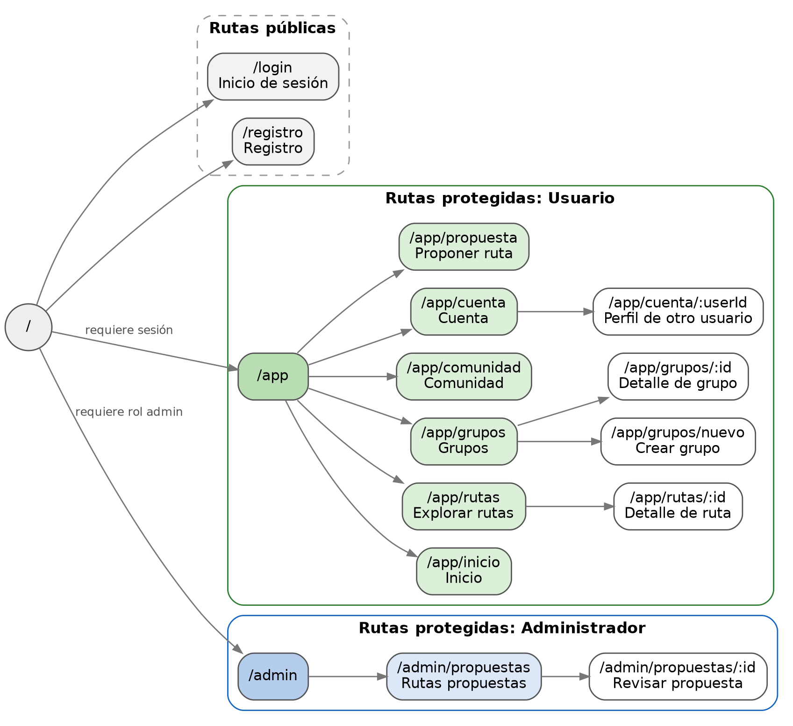

### Acceso según rol

- Si alguien sin sesión intenta entrar a `/app` o `/admin`, se le redirige a `/login`.
- Si un usuario que no es administrador intenta entrar a `/admin`, se le redirige a `/app/inicio`.
- Si alguien con sesión entra a `/login` o `/registro`, se le lleva a su pantalla de inicio.

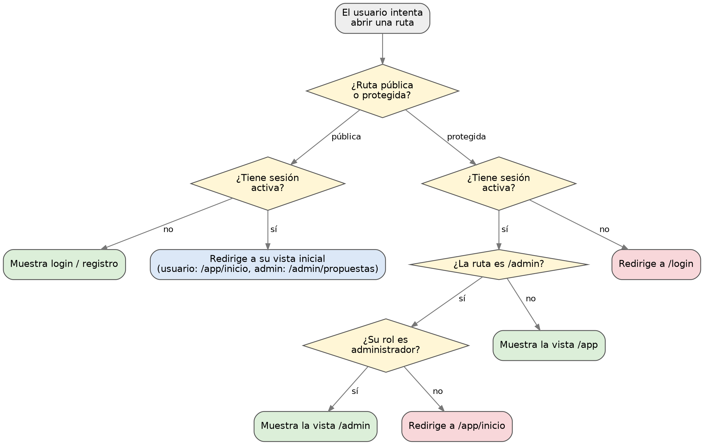 

### Navegación en móvil y web

- **Móvil:** barra inferior con Inicio, Rutas, Grupos, Comunidad y Cuenta. Proponer ruta y cerrar sesión están en el menú desplegable.
- **Web:** menú lateral fijo con todas las opciones y el botón Proponer ruta.

### Task flows

**Participar en un grupo**

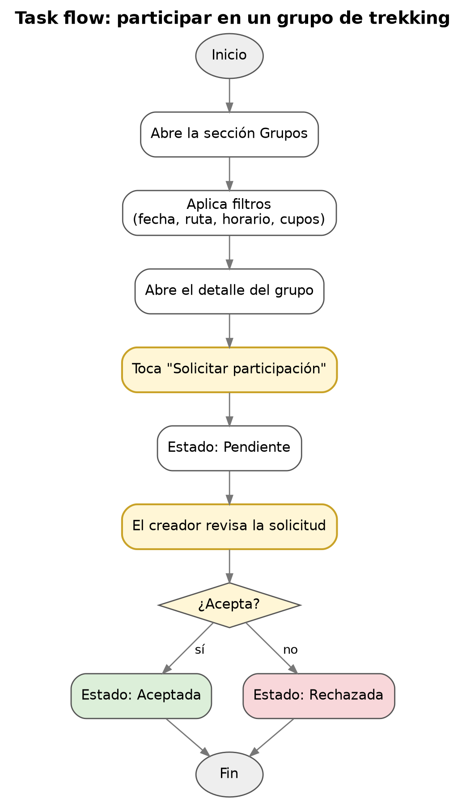

**Proponer una ruta**

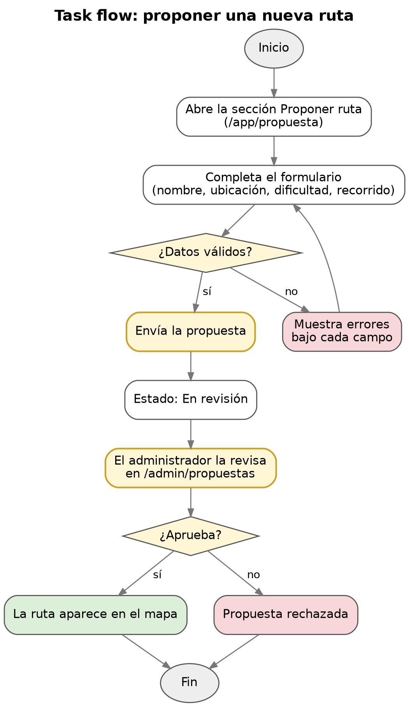

**Consultar una ruta**

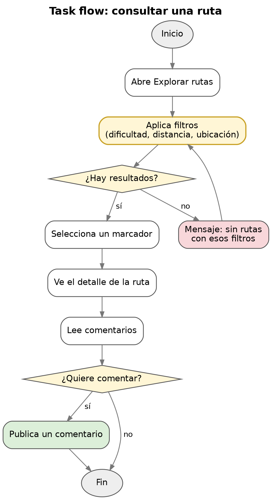


## Capturas

| Pantalla | Web |
|---|---|---|
| Inicio de sesión | 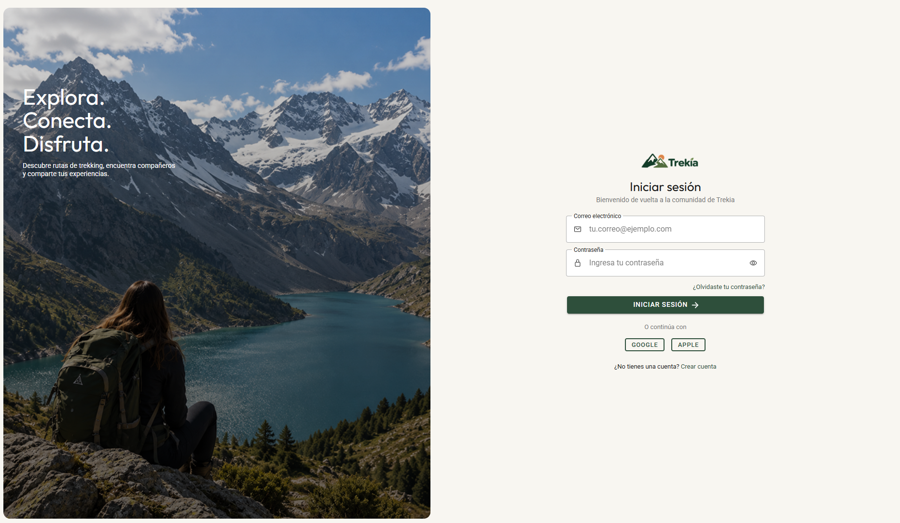 | 
| Registro | 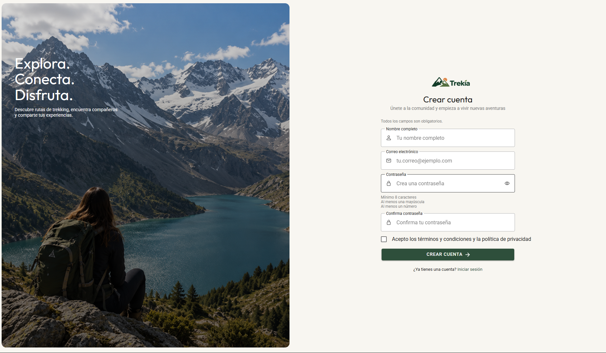 | 
| Inicio | 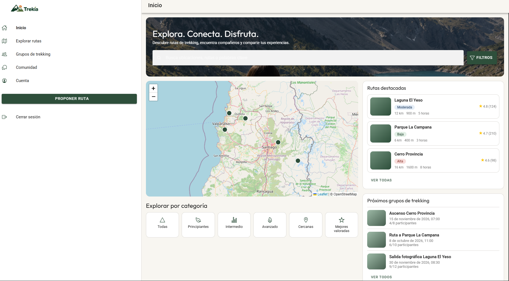 |
| Explorar rutas | 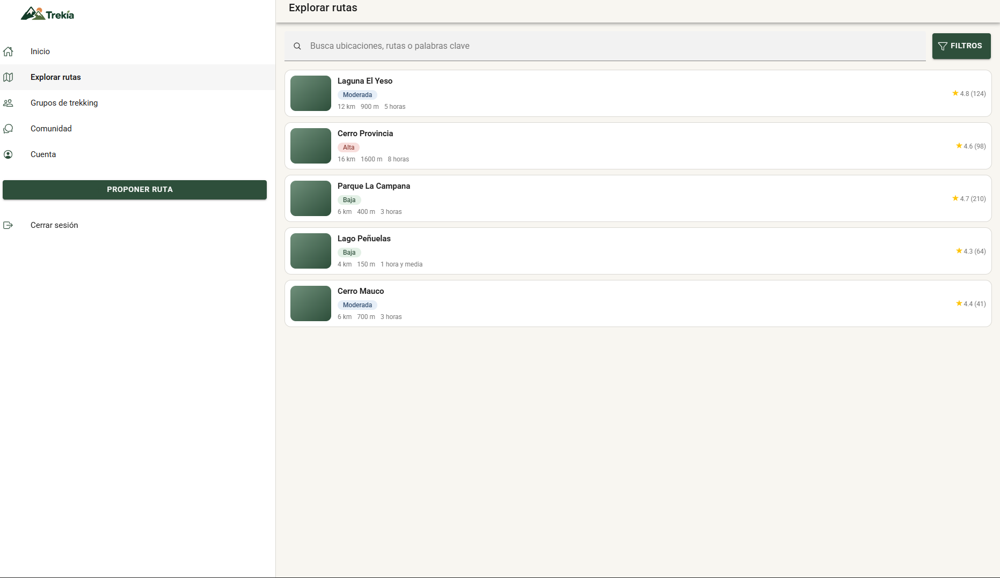 | 
| Comunidad | 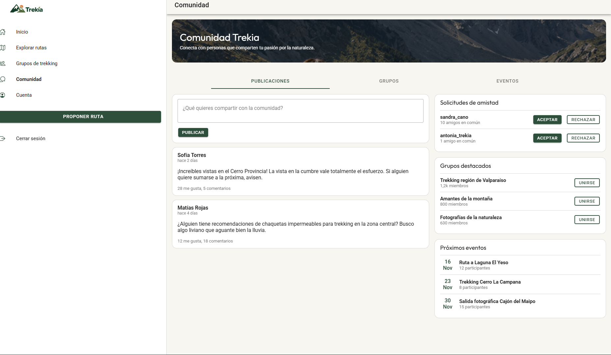 | 
| Cuenta | 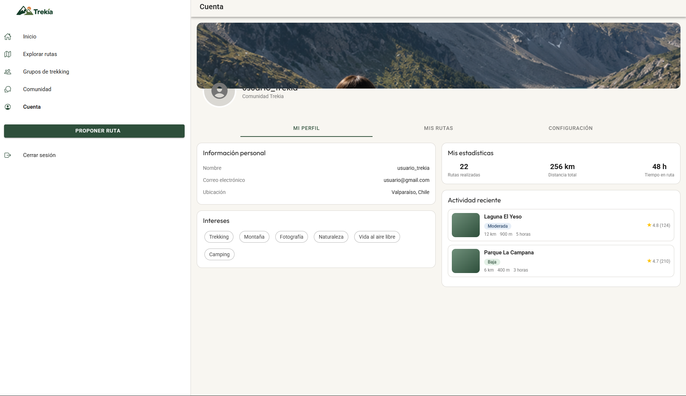 | 

---

## Recursos externos

- **Mapas:** © colaboradores de [OpenStreetMap](https://www.openstreetmap.org/copyright).
- **Íconos:** [Ionicons](https://ionic.io/ionicons).
- **Tipografías:** [Roboto](https://fonts.google.com/specimen/Roboto) y [Outfit](https://fonts.google.com/specimen/Outfit), de Google Fonts.
- **Fotografía de las portadas (`fondo_trekking_2.png`):** _completar con el autor y la fuente de la imagen_.
- **Fuentes del problema:** [SENAPRED](https://senapred.cl/), [CONAF](https://www.conaf.cl/) y [AllTrails](https://www.alltrails.com/).
