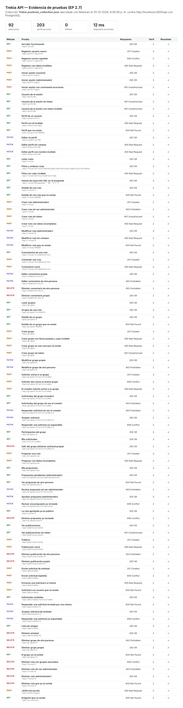

# EP 2.7 — Pruebas funcionales

## Archivos

| Archivo | Contenido |
|---|---|
| `Trekia.postman_collection.json` | Colección de Postman con 92 peticiones y 203 verificaciones |
| `endpoints.md` | Documentación de cada endpoint: método, parámetros, autenticación, respuestas y errores |
| `evidencia/evidencia-pruebas.png` | Captura con el resultado de cada prueba |
| `evidencia/reporte-newman.html` | Reporte completo de la ejecución, con cada petición y respuesta (se abre en el navegador) |
| `evidencia/resultado-newman.txt` | Salida de la ejecución en la terminal |

## Cómo ejecutar las pruebas

1. Crear la base de datos desde cero, para que los ids coincidan con los de la colección:

   ```bash
   dropdb -U postgres --if-exists trekia
   createdb -U postgres trekia
   psql -U postgres -d trekia -f database/trekia_schema.sql
   psql -U postgres -d trekia -f database/datos_prueba.sql
   ```

2. Levantar el servidor con `npm run dev`.

3. En Postman: **Import** → elegir `docs/Trekia.postman_collection.json` → clic derecho en la colección → **Run collection** → **Run Trekia API**. Las peticiones deben ejecutarse en orden, porque las primeras guardan los tokens y los ids que usan las siguientes.

   Desde la terminal, dentro de `backend/`:

   ```bash
   npx newman run docs/Trekia.postman_collection.json
   ```

La colección usa la variable `baseUrl` (`http://localhost:3000/api`). Los tokens (`tokenUsuario`, `tokenAdmin`, `tokenOtro`) y los ids creados durante las pruebas se guardan solos en las variables de la colección.

Los inicios de sesión y registros tienen un límite por IP (10 inicios de sesión cada 15 minutos y 5 registros por hora). Cada ejecución completa hace 4 y 3, así que para correrla varias veces seguidas hay que reiniciar el servidor entre ejecuciones.

## Qué se prueba

Cada petición verifica el código HTTP y que la respuesta tenga el formato `{ ok, data, message, errors }`. Algunas verifican además el contenido de la respuesta.

| Carpeta | Casos exitosos | Casos de error |
|---|---|---|
| Salud | Servidor funcionando | — |
| Autenticación | Registro (ignora el campo `rol`), inicio de sesión de usuario y administrador, usuario de la sesión | Correo repetido (409), datos inválidos (400), contraseña incorrecta (401), sin token y token inválido (401) |
| Usuarios | Perfil de un usuario, editar mi perfil | Id inválido (400), usuario inexistente (404), editar sin campos o con nombre inválido (400) |
| Rutas | Listar, filtrar y ordenar, detalle, crear, modificar y eliminar como administrador | Filtro inválido (400), inyección SQL en la búsqueda (se trata como texto), ruta inexistente (404), crear sin ser administrador (403) y sin token (401), datos incompletos (400), modificar sin campos (400), eliminar una ruta con grupos (409) |
| Comentarios | Listar, comentar, editar y eliminar el comentario propio | Comentario vacío (400), editar o eliminar el comentario de otra persona (403) |
| Grupos | Listar, filtrar por ruta, detalle, crear, modificar y eliminar el grupo propio | Grupo inexistente (404), fecha pasada y cupo inválido (400), ruta inexistente (400), sin token (401), modificar o eliminar el grupo de otra persona (403) |
| Solicitudes | Solicitar unirse, ver las solicitudes del grupo, aceptar, contar participantes, ver mis solicitudes, salir del grupo | Solicitar dos veces (409), el creador solicita unirse (400), ver o responder sin ser el creador (403), responder una solicitud ya respondida (409) |
| Propuestas | Proponer, ver mis propuestas, ver las pendientes como administrador, aprobar (se publica la ruta) | Datos incompletos (400), ver la propuesta de otra persona (404), revisar sin ser administrador (403), revisar dos veces (409), eliminar una propuesta ya revisada (409) |
| Publicaciones | Ver publicaciones, publicar, eliminar la publicación propia | Sin token (401), publicación vacía (400), eliminar la publicación de otra persona (403) |
| Amistades | Enviar solicitud, ver solicitudes recibidas, aceptar, ver amigos, eliminar amistad | Solicitud repetida (409), a uno mismo (400), a un usuario inexistente (404), responder una solicitud enviada por uno mismo (404), responder dos veces (409) |
| Errores generales | — | JSON mal escrito (400), endpoint inexistente (404) |

## Resultado

Ejecución del 25 de octubre de 2026 con Newman, contra el servidor local y PostgreSQL con `trekia_schema.sql` y `datos_prueba.sql`:

| Peticiones | Verificaciones | Fallidas | Tiempo promedio de respuesta |
|---|---|---|---|
| 92 | 203 | 0 | 12 ms |


